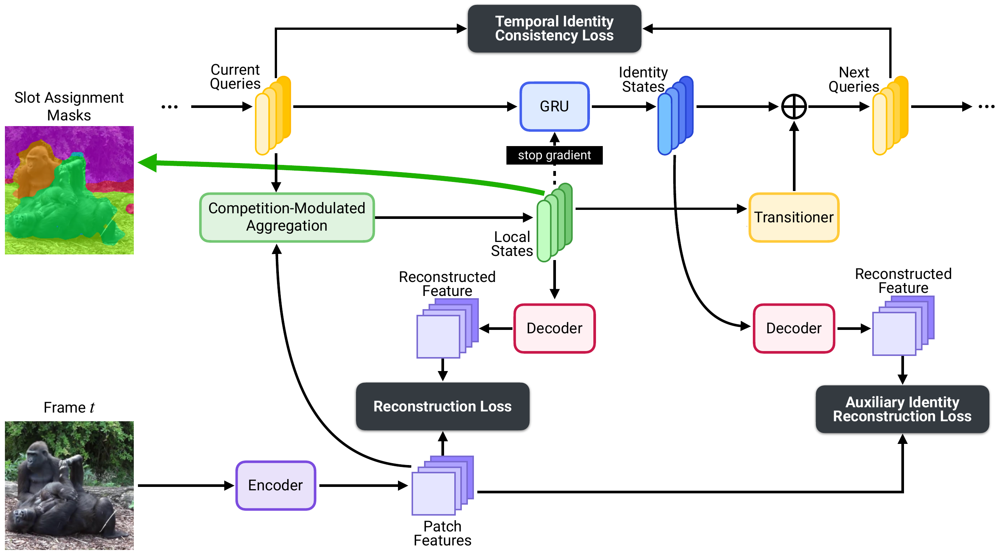
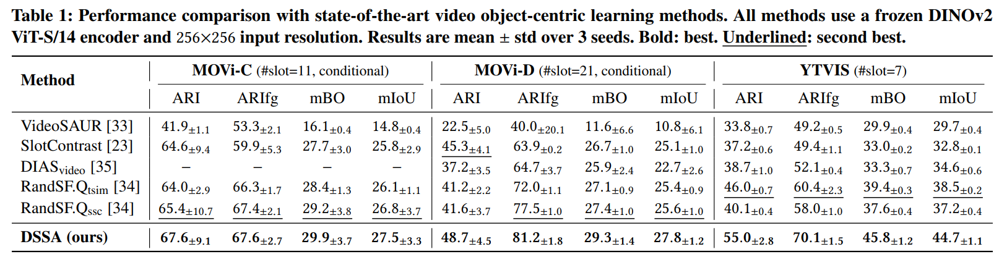
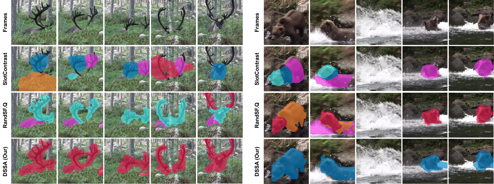

# `DSSA` Dual-State Slot Attention: Decoupling Appearance and Identity for Video Object-Centric Learning


[](https://arxiv.org/abs/2606.12601)
[](https://arxiv.org/abs/2606.12601)
[](LICENSE)


Unsupervised video object-centric learning aims to decompose dynamic scenes into persistent, object-level representations without supervision. However, existing slot-based methods struggle to maintain stable object identity in challenging settings such as rapid motion and partial occlusion. First, they typically encode both the per-frame appearance of an object and its identity across frames in a single slot vector, creating an objective conflict that leads to slot swapping: reconstruction requires sensitivity to transient visual changes, whereas temporal consistency requires invariance to them. Second, the token renormalization used in Slot Attention can amplify weakly attending slots, allowing them to absorb tokens from other objects and destabilize slot-to-object correspondence.

We propose **Dual-State Slot Attention (DSSA)**, a fully self-supervised framework that addresses these limitations by separating appearance from identity and by reducing spurious updates from weakly matching slots. DSSA decomposes each slot into a **local state** for per-frame appearance and an **identity state** for temporally stable object information, thereby aligning reconstruction and temporal consistency with separate representations. The identity state is updated through a learned recurrent transition that acts as a temporal filter on the local state, while **competition-modulated aggregation (CMA)** down-weights updates from weakly matching slots and prevents them from absorbing tokens from other objects. Experiments on MOVi-C, MOVi-D, and YouTube-VIS demonstrate that DSSA consistently improves segmentation quality and temporal consistency over prior methods, while also yielding stronger downstream object recognition and video dynamics prediction.


## 🎉 Accepted to ACM MM 2026

Official source code and model checkpoints for paper "**Dual-State Slot Attention: Decoupling Appearance and Identity for Video Object-Centric Learning**".

**Our model architecture**:



## 🏆 Performance

**Object discovery accuracy**: (Input resolution is **256×256**; **DINO2 ViT-S/14** is used for encoding; mean ± std over 3 random seeds)



**Object discovery visualization**:




## 🧭 Repo Structure

```shell
- config-dssa/            # *** configs for our DSSA ***
- config-randsfq/         # configs for baseline RandSF.Q
- config-randsfq-tsim/    # configs for baseline RandSF.Q with time similarity loss
- config-slotcontrast/    # configs for baseline SlotContrast
- config-videosaur/       # configs for baseline VideoSAUR
- object_centric_bench/
  - datum/                # dataset loading and preprocessing
  - model/                # model building
    - ...
    - dssa.py             # *** our DSSA model: ``DSSA`` and ``SlotAttention_CMA`` ***
    - ...
  - learn/                # metrics, optimizers and callbacks
- train.py
- eval.py
- requirements.txt
```

DSSA configs follow the naming `dssa_<init>[_recogn]-<dataset>[-<variant>].py`, where `c` means slots are conditioned on the first-frame bounding boxes and `r` means slots are randomly initialized:

| Config | Task | Dataset | Note |
|---|---|---|---|
| `dssa_c-movi_c.py` | object discovery | MOVi-C | |
| `dssa_c-movi_d.py` | object discovery | MOVi-D | |
| `dssa_r-ytvis_hq.py` | object discovery | YTVIS-HQ | |
| `dssa_r_recogn-ytvis_hq.py` | object recognition | YTVIS-HQ | uses the local slots |
| `dssa_r_recogn-ytvis_hq-identity.py` | object recognition | YTVIS-HQ | uses the identity slots |


## 🚀 Converted Datasets

We use the datasets converted into LMDB format by [RandSF.Q](https://github.com/Genera1Z/RandSF.Q), which can be used off-the-shelf:
- [dataset-movi_c](https://github.com/Genera1Z/RandSF.Q/releases/tag/dataset-movi_c): converted dataset [MOVi-C](https://github.com/google-research/kubric/blob/main/challenges/movi).
- [dataset-movi_d](https://github.com/Genera1Z/VQ-VFM-OCL/releases/tag/dataset-movi_d): converted dataset [MOVi-D](https://github.com/google-research/kubric/blob/main/challenges/movi).
- [dataset-ytvis_hq](https://github.com/Genera1Z/RandSF.Q/releases/tag/dataset-ytvis_hq): converted dataset YTVIS, the [high-quality](https://github.com/SysCV/vmt?tab=readme-ov-file#hq-ytvis-high-quality-video-instance-segmentation-dataset) version.

Unzip them to `path/to/your/dataset/`, so that it contains `movi_c/`, `movi_d/` and `ytvis_hq/`.


## 🧠 Model Checkpoints

**The checkpoints (@ random seeds 42, 43 and 44) of all DSSA models** will be released soon. All backbones are DINO2 ViT-S/14.

```shell
- weights/
  - dssa_c-movi_c/                    # 42_0038.pth  43_0035.pth  44_0026.pth
  - dssa_c-movi_d/                    # 42_0024.pth  43_0020.pth  44_0025.pth
  - dssa_r-ytvis_hq/                  # 42_0099.pth  43_0086.pth  44_0094.pth
  - dssa_r_recogn-ytvis_hq/           # 42_0021.pth  43_0021.pth  44_0022.pth
  - dssa_r_recogn-ytvis_hq-identity/  # 42_0020.pth  43_0021.pth  44_0022.pth
```

Each checkpoint folder is named after its config file in `config-dssa/`, and each file is named `<seed>_<epoch>.pth`.

For object recognition, the slots extracted by a frozen pretrained DSSA are matched with ground-truth object segmentations by threshold 1e-1@IoU, and the matched slots are used to train category classification and bounding box regression. The recognition checkpoints contain both the frozen DSSA and the recognition head.


## 🔥 How to Use

**(1) Environment**: Install [PyTorch](https://pytorch.org), then run `pip install -r requirements.txt`.

**(2) Dataset**: Download ***Converted Datasets*** and unzip to `path/to/your/dataset/`.

**(3) Train**:
```shell
python train.py --seed 42 --cfg_file config-dssa/dssa_c-movi_c.py --data_dir path/to/your/dataset
```

**(4) Evaluate**:
```shell
python eval.py --cfg_file config-dssa/dssa_c-movi_c.py --data_dir path/to/your/dataset --ckpt_file path/to/checkpoint.pth
```

Replace `--cfg_file` with any config in `config-dssa/`. For object recognition, `train.py` also takes the pretrained DSSA checkpoint via `--ckpt_file`.


## 🙏 Acknowledgement

This repo is built upon [RandSF.Q](https://github.com/Genera1Z/RandSF.Q) (AAAI 2026) and its codebase [VQ-VFM-OCL](https://github.com/Genera1Z/VQ-VFM-OCL). We thank the authors for releasing their code, converted datasets and baseline implementations, including [VideoSAUR](https://arxiv.org/abs/2306.04829) and [SlotContrast](https://arxiv.org/abs/2412.14295).


## 🤗 Contact

<!-- TODO: add contact email / page -->
If you have any issues with this repo, please open an issue.


## 📚 Citation

If you find this repo useful, please cite our work.
```
@inproceedings{tran2026dssa,
  title={{Dual-State Slot Attention: Decoupling Appearance and Identity for Video Object-Centric Learning}},
  author={Tran, Sieu and Nguyen, Duc and Vo, Hao and Vo, Khoa and Le, Ngan},
  booktitle={Proceedings of the 34th ACM International Conference on Multimedia},
  year={2026}
}
```
